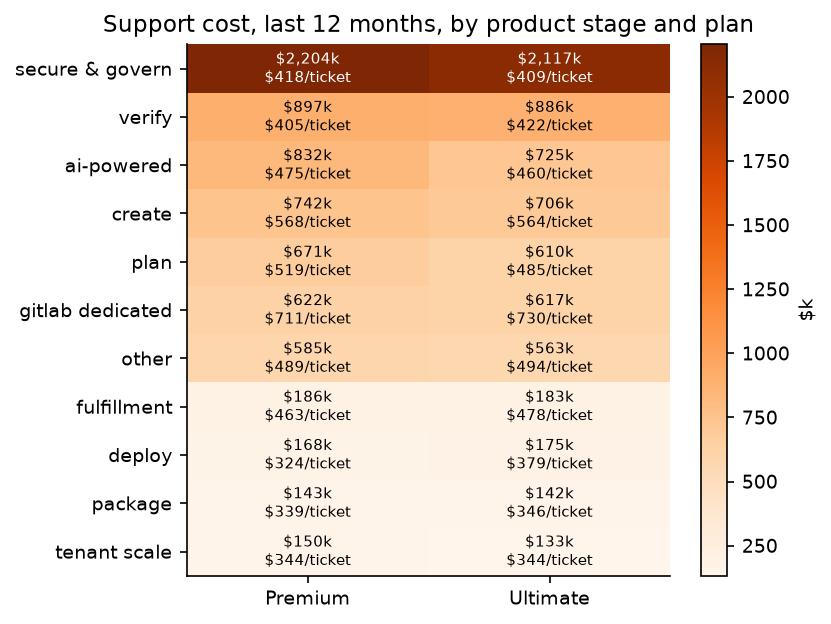
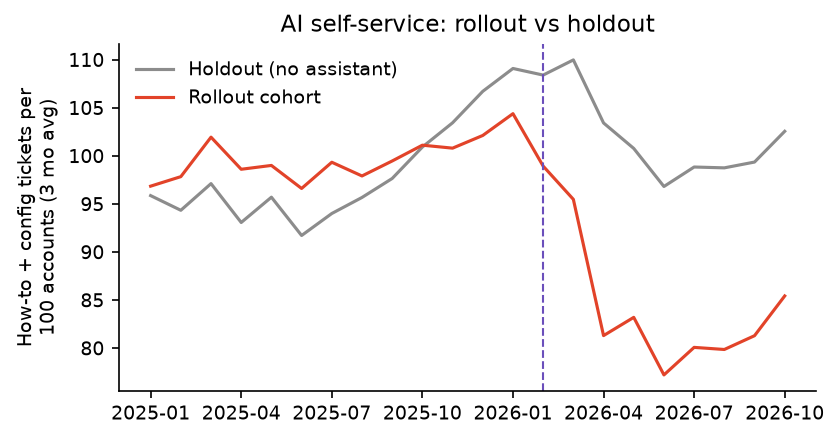
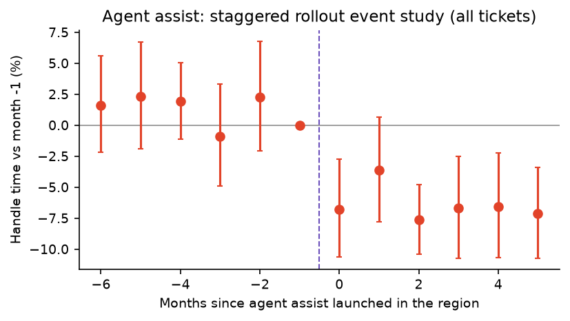
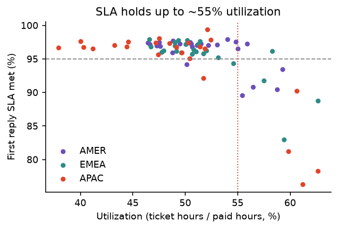

# Support economics: what support costs, what AI saves, who is at risk

A support analytics model for a DevSecOps support org: **cost per ticket by product stage and plan, AI ROI measured against a holdout, a churn model on support signals, and an FY28 headcount plan**, rolled into a one-page Monthly Business Review.

SQL marts in DuckDB over Zendesk-, Salesforce- and billing-shaped extracts. Ticket data is private everywhere, so tickets are simulated for 1,500 accounts and 58,009 tickets over 24 months (Nov 2024 to Oct 2026). The product side is real: stage mix, bug share and issue complexity are calibrated to **2,003 public `gitlab-org/gitlab` issues labeled `customer`**, pulled from the GitLab API. KPI targets (first reply SLA 95%, SSAT 95%) follow GitLab's public Support performance indicators. The simulation plants known AI effects, so every estimate below can be checked against the truth.

**[Open the one-page MBR](https://v391.github.io/gitlab-support-economics/reports/mbr.html)** (source: [`reports/mbr.html`](reports/mbr.html)).

## Headlines

| Question | Answer |
|---|---|
| What does a ticket cost? | **$458** fully loaded over the last 12 months ($14.1M). Payroll is spread onto tickets by work time, and the allocation reconciles to payroll within 0.1% every region-month (data test). |
| Where does support cost go? | **Secure & Govern** costs the most and carries the most product quality cost: **$890k** of support time went to tickets that ended in an engineering escalation, out of **$3.0M** across all stages. |
| Did AI self-service work? | Yes, but at a quarter of what the bot claims. Rollout accounts filed **20% fewer** how-to and config tickets than the holdout (95% CI 15% to 24%; planted truth 22%): **142 tickets a month**. The assistant marks **613** conversations a month as resolved. |
| Did agent assist work? | **11% less handle time when used** (CI 8% to 14%; planted truth 14%). The naive "used vs not used" comparison says **48%**, because engineers use it on easy tickets: 70% of assisted tickets are easy how-to, config or licensing work, against 34% of the rest. |
| Which customers are at risk? | A logistic model on six months of support signals, trained on renewals before Feb 2026 and tested after: **AUC 0.80**, the top decile holds **40%** of churned renewals (4.1x lift). **81 accounts, $34.8M ARR**, renewing by Feb 2027 are flagged with the two signals driving each score. |
| What headcount does FY28 need? | **100 engineers** at today's AI footprint (95 today), **95** if self-service reaches every account, **113** without AI. Sized to the peak month at a **55% utilization ceiling** read off the data: above it, first reply SLA drops under 95%. |



## How AI ROI is measured, not assumed

**Self-service (customer side).** The assistant went live in Feb 2026 for a random half of accounts; the other half is a holdout. Difference in differences on account-months, account-level cluster bootstrap for the interval. Pre/post on the rollout cohort alone says 18%: it mixes the AI effect with seasonality and growth. The bot's own "resolved" counter says 613 a month: it counts every thumbs up, including people who then filed a ticket anyway.



**Agent assist (engineer side).** Launched EMEA Mar 2026, AMER Jun 2026, APAC Sep 2026. The staggered launch is the control: regression of log handle time on availability with region, month, category, priority, stage and deployment fixed effects (intention to treat, -6.4%), scaled by the 54% usage rate to the effect when used (-11%). The event study shows no pre-trend.



**What the savings are worth.** Self-service frees 253 engineer hours a month: $20k at direct payroll cost, $39k at fully loaded cost per ticket. Freed hours are capacity, not cash, until the hiring plan changes, which is why the FY28 plan prices AI in headcount.

## Capacity planning



Each dot is a region-month. SLA holds up to about 55% of paid hours on tickets (the rest is leave, training, meetings, internal work and follow-the-sun cover), then falls fast. The APAC cluster at the bottom right is June to August 2026, after four engineers left in May; the October dips are the seasonal peak. The FY28 plan (Feb 2027 to Jan 2028, GitLab's fiscal year) projects volume per region from the 24-month trend with AI effects removed, then applies each scenario:

| Scenario | FY28 tickets | Engineers needed | Payroll |
|---|---|---|---|
| No AI | 37,274 | 113 | $18.1M |
| Today's AI footprint | 35,485 | 100 | $16.3M |
| AI self-service on all accounts | 33,695 | 95 | $15.5M |
| High growth +15%, AI scaled | 38,749 | 110 | $17.8M |

## Unified customer schema

Three systems, three keys: Zendesk organizations, Salesforce accounts, billing subscriptions. `int_org_account_map` maps every Zendesk org to exactly one account with three ranked rules: Salesforce id on the org (890 orgs), Zendesk id on the account (518), email domain (152). 4% of accounts have a second Zendesk org from a regional domain; both roll up to one account. Data tests caught two real modeling bugs while building this: a truncated hash that gave three orgs the same Salesforce id, and two accounts sharing a name and domain.

## Repo

```
src/fetch_gitlab_issues.py   real gitlab-org customer issues (public API, month by month)
src/generate.py              source extracts with planted AI and churn effects
models/staging/              one typed view per source system
models/intermediate/         org to account crosswalk
models/marts/core.sql        dim_account, fct_tickets (fully loaded cost), monthly payroll vs work
models/marts/analysis_marts.sql  stage x plan cost, quality cost, scorecards, alerts, renewals, AI panels, MBR
tests/data_tests.sql         10 data tests, the build fails if any returns rows
src/analyze.py               DiD, event study, churn model, capacity plan, charts
src/mbr.py                   one-page MBR
```

| Mart | Grain | Use |
|---|---|---|
| `fct_tickets` | ticket | every metric; loaded cost, account, engineer, AI flags |
| `mart_stage_plan_cost` | stage x plan | support economics heatmap |
| `mart_stage_quality` | stage | product quality cost next to real public issues |
| `mart_agent_month` | engineer x month | utilization and team performance scorecard |
| `mart_region_week`, `mart_alerts` | region x week | SLA two weeks under 95%, volume spikes (2.5 sigma) |
| `mart_renewals`, `mart_account_current` | renewal, account | churn model training and live scoring |
| `mart_self_service_panel` | account x month | AI deflection experiment |
| `mart_mbr_month` | month | MBR telemetry |

Every mart is plain SQL, so it ports to Snowflake/dbt and to Zendesk Explore or Tableau as the reporting layer.

```bash
pip install -r requirements.txt
python src/fetch_gitlab_issues.py   # optional, the CSV is committed
python src/generate.py
python src/analyze.py               # builds data/warehouse.duckdb, runs tests, writes reports/
```
